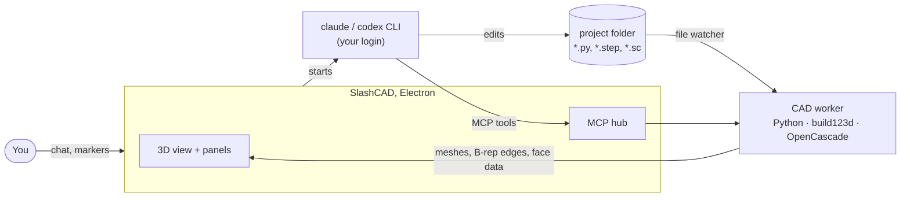

<p align="center">
  
</p>

<h1 align="center">SlashCAD</h1>

<p align="center">
  A local CAD workbench where AI coding agents build your 3D models while you watch, steer and measure.
</p>

---

SlashCAD is a desktop app (Linux, Windows; macOS builds via CI) that puts a live CAD view between
you and an AI agent. You describe a part in plain language ("a 120 mm mounting bracket with four
counterbored M3 holes and a lid"). **Claude Code** or **ChatGPT (Codex)** writes and edits
[build123d](https://github.com/gumyr/build123d) Python scripts in your project folder. Every
save is rebuilt with OpenCascade and shown in the 3D view within a fraction of a second. You can
orbit, zoom, section and measure the model at any time, including while the agent is working.

It runs the `claude` and `codex` command-line tools you already use, with your existing
subscription. There are no API keys and no extra credits, and nothing leaves your machine except
the agents' own traffic to their providers.

```
┌──────────────┬──────────────────────────────────────┬─────────────────────┐
│ Files        │                                      │ Claude │ ChatGPT    │
│ Model tree   │          live 3D CAD view            │ chat, tool calls,   │
│ Parameters   │  (orbit · section · measure · mark)  │ approvals, tokens,  │
│ Changes      │                                      │ usage limits,       │
│ Builds       │                                      │ markers / tasks     │
└──────────────┴──────────────────────────────────────┴─────────────────────┘
```

> **Status:** early development (0.3). Daily use on Linux (Fedora, GNOME, Wayland) with Claude
> Code. The Windows packages are cross-built and the macOS build exists only as a CI job: neither has
> been tested on real hardware yet. Codex/ChatGPT support is implemented and connects, but has seen
> less end-to-end use than Claude.

## What it is for

- **Designing parts by talking.** Describe what you need, look at the result, point at the part
  that is wrong and say what to change. The model is code, so every step is reproducible,
  diffable and editable by hand.
- **Seeing what the agent does.** In a plain terminal or editor, an agent edits CAD scripts blind.
  Here every edit appears in the view as it happens. Changed parts can be compared with their
  previous version, and each build is logged with errors and timings.
- **Giving precise feedback.** Click a face, drop a numbered marker and write a task on it
  ("make this hole Ø4", "round these edges 2 mm"). The agent receives the exact geometry (face type,
  diameter, axis, normal), works through the list and resolves each marker with a note.
- **Working with existing models.** Open STEP files (also single files, without a project), measure
  them, and let the agent design new parts that fit them.

## How it works



1. **Agents.** SlashCAD starts your own, unmodified `claude` (Claude Code) or `codex` (Codex CLI)
   binary as a child process and talks to it over its streaming JSON protocol. Approvals for file
   edits and commands appear as cards in the chat. Token use, context size and the subscription's
   5-hour and weekly limits are shown as they arrive.
2. **CAD tools over MCP.** Each agent session gets SlashCAD's MCP server (`slashcad`) with these tools:
   `build`, `get_scene`, `set_scene`, `inspect` (volume, area, bounding box, centre of mass, validity),
   `measure` (distance or interference between parts), `render_view` (a PNG from any standard view,
   without moving your camera), `highlight`, `export` (STEP/STL/GLB/BREP), `list_annotations` and
   `resolve_annotation`.
3. **CAD worker.** A resident Python process (bundled CPython 3.13 with build123d and OpenCascade)
   runs the scripts. It caches STEP imports as BREP and meshes each part. It sends only changed parts
   to the view, together with B-rep edges and face ranges, so picking selects real CAD faces.
4. **The view.** It is a three.js viewer with CAD-style navigation (Fusion 360 by default, plus
   SolidWorks and Onshape mappings), a view cube, standard views, perspective/orthographic,
   shaded-with-edges and X-ray modes, section planes with caps, measuring, "Before" ghosts of
   changed parts, contact shadow and ambient occlusion.

## Install

Download a package from the [Releases](../../releases) page:

| System  | File | Notes |
|---------|------|-------|
| Linux   | `SlashCAD-<version>-x86_64.AppImage` | `chmod +x` and run. Adds itself to the application menu on first start. |
| Debian, Ubuntu | `slashcad_<version>_amd64.deb` | `sudo apt install ./slashcad_<version>_amd64.deb` |
| Fedora, openSUSE | `slashcad-<version>.x86_64.rpm` | `sudo dnf install ./slashcad-<version>.x86_64.rpm` |
| Windows | `SlashCAD-Setup-<version>.exe` | Installer (per user, choice of folder). |
| Windows | `SlashCAD-Portable-<version>.exe` | Single exe; keeps its settings in `SlashCAD-data` next to it. |
| Windows | `SlashCAD-<version>-win-x64.zip` | Unzip and run `slashcad.exe`; starts faster than the portable exe. |

The packages include their own Python and CAD kernel. You only need at least one agent CLI,
installed and logged in:

- **Claude Code** with a Claude subscription (Pro or Max). The CLI or the VS Code extension both work.
- **Codex CLI** with a ChatGPT login (Plus, Pro, Team…). The CLI or the VS Code "ChatGPT/Codex"
  extension both work.

SlashCAD finds them in the VS Code / Cursor / Windsurf extensions, the native installers
(`~/.local/bin`), npm global installs (including Windows `.cmd` shims), WinGet, Scoop, Homebrew and
`PATH`. You can also set a path in *Settings › Agents*. If an agent is not logged in, *Log in with
Claude* / *Log in with ChatGPT* opens the provider's own login page.

## Quick start

1. Start SlashCAD and choose **Open folder…** (a project) or **Open file…** (a single STEP, `.py`,
   `.brep` or `.sc` file).
2. In a new folder, ask the agent for something, for example: *"Create main.py with a 60×40×6 mm plate
   with 4 mm corner fillets and four Ø3.4 holes 5 mm from the edges."*
3. Watch the part appear. Orbit with the right mouse button, pan with the middle button, zoom with
   the wheel.
4. To change something, click a face and press **P** to mark it, write the task, then *Send open
   markers to the agent*. Or just say what to change.
5. Top-level numbers such as `WIDTH = 120` show up in the **Parameters** tab. Type or drag them
   and the model rebuilds immediately.

A model script is ordinary build123d code:

```python
from build123d import Axis, Box, BuildPart, fillet
from slashcad import show

WIDTH = 80  # mm, editable in the Parameters tab

with BuildPart() as plate:
    Box(WIDTH, 40, 6)
    fillet(plate.edges().filter_by(Axis.Z), radius=4)

show(plate, name="plate", color="steelblue")
```

`show()` (or `ocp_vscode.show`, `show_object`, or a variable named `result`) puts a part in the
scene. `load_step("model.step")` from `slashcad` returns an existing STEP model as a cached
build123d shape, so new parts can be fitted to it.

## Privacy and safety

- **Local only.** No telemetry, no accounts, no cloud service of its own. The app makes no network
  requests itself. Even Chromium's spell-check dictionary download is disabled.
- **No API billing.** `ANTHROPIC_API_KEY`, `OPENAI_API_KEY` and similar variables are removed
  from the agents' environment. If Claude Code is logged in with a Console/API account, the app warns
  you that it would bill the API instead of your subscription.
- **No stored credentials.** SlashCAD never reads the agents' credential files. Login is handled by
  the agents' own login flows.
- **Scripts run only in folders you trust.** Python model scripts are executed by the CAD worker, so
  a newly opened folder runs nothing until you click *Trust and build*. A new folder only offers
  scripts that import build123d/CadQuery as models, and STEP files can always be viewed. Single files
  (*Open file…*) keep all their state in the app's data folder, so nothing is written next to them.
- **Agents stay in the project.** They are told to work only inside the project folder, and file
  edits and commands go through the approval cards (unless you allow them).

## SolidCraft (optional)

If [SolidCraft](https://github.com/tangency-labs/solidcraft) is installed, agent sessions also get
SolidCraft's own MCP tools. With SolidCraft open, the agent models directly in its window
(parametric timeline, sketches, constraints). Otherwise SolidCraft runs headless. `.sc` designs in
the project can be shown in SlashCAD's view: they are exported to STEP on every save, so markers,
measuring and sections work on them too. SolidCraft is a separate project (MIT OR Apache-2.0) and is
neither bundled nor modified.

## Use from VS Code

VS Code does not need to be running. If you prefer to chat with Claude Code inside VS Code, use
*Settings › Agents › Connect the CAD tools to VS Code*. It writes a `.mcp.json` into the project
(no secrets in it), so Claude Code in VS Code can use the same CAD tools while SlashCAD shows the
model.

## Navigation

The defaults follow Fusion 360:

- Right-drag orbits, middle-drag pans, and the wheel zooms toward the cursor.
- Right-click opens the context menu, and a middle double-click goes Home.

*Settings › Navigation* offers:

- SolidWorks and Onshape mappings and free orbit.
- Orbiting around the origin or the point under the cursor.
- Zoom options and animation.

These always work:

- Alt + left-drag orbits.
- Alt + Shift + left-drag pans.
- Double-click zooms to a part.
- The tool buttons at the bottom make the left button orbit, pan or zoom, which helps on a touchpad.

Keys: `F` fit, `H`/`0` home, `1` front, `3` right, `7` top, `5` perspective/orthographic,
`M` measure, `P` mark, `R` orbit tool, `Esc` clear.

The UI is in English, and Swedish can be chosen in *Settings › General*.

## Building from source

Requires Node.js 22+ and Python 3.13.

```sh
npm install
npm run python:setup          # .venv with the pinned build123d versions
npm run dev                   # build and start (Wayland first on Linux)
```

`SLASHCAD_DISPLAY=x11 npm start` forces X11. On Linux the app prefers Wayland and switches
itself to X11 after repeated GPU-process crashes.

Packages:

```sh
npm run python:setup -- --bundle                 # relocatable CPython + build123d in build/python-runtime
npm run dist:linux                               # AppImage, deb, rpm in release/
node scripts/setup-python.mjs --bundle --target win
npm run dist:win                                 # NSIS installer, portable exe, zip
```

`npm run icon` copies the icon set from `build/SlashCAD-transparent-icons` to the places the build
uses. `npm run notices` regenerates `THIRD-PARTY-NOTICES.md` after dependency changes.

### Repository layout

| Path | Contents |
|------|----------|
| `src/main/` | Electron main process: projects, build queue, CAD worker supervision, MCP hub and tools, agent sessions (`agents/`), SolidCraft integration, desktop integration |
| `src/mcp/server.ts` | The stdio MCP server the agents start; it forwards to the running app |
| `src/renderer/` | React UI and the three.js CAD viewer (`viewer/`) |
| `python/slashcad_worker/` | The resident CAD worker (build123d, STEP/BREP/SC loading, meshing, inspect/measure/export) |
| `scripts/` | Build, start, Python runtime setup, icons, licence notices |
| `examples/demo/` | The demo project shown on first start |
| `spikes/` | Early measurements that informed the design (Electron vs WebKitGTK, agent bridges, STEP caching) |

## License

MIT, see [LICENSE](LICENSE). You are free to use, change and redistribute it, also commercially.

The packages bundle third-party software under its own licences: Electron/Chromium, CPython,
build123d, Open CASCADE Technology (LGPL-2.1 with the Open CASCADE exception), NumPy, SciPy and
others. See [THIRD-PARTY-NOTICES.md](THIRD-PARTY-NOTICES.md). Claude Code, Codex and SolidCraft
are not bundled and are subject to their own terms.

## Support

Like SlashCAD? Buy me a beer 🍺

[](https://ko-fi.com/slashmad)
[](https://liberapay.com/slashmad/)
